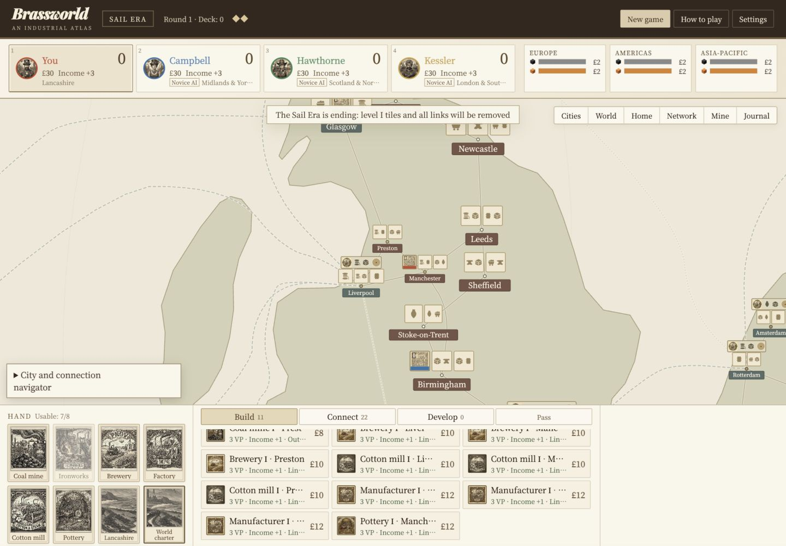
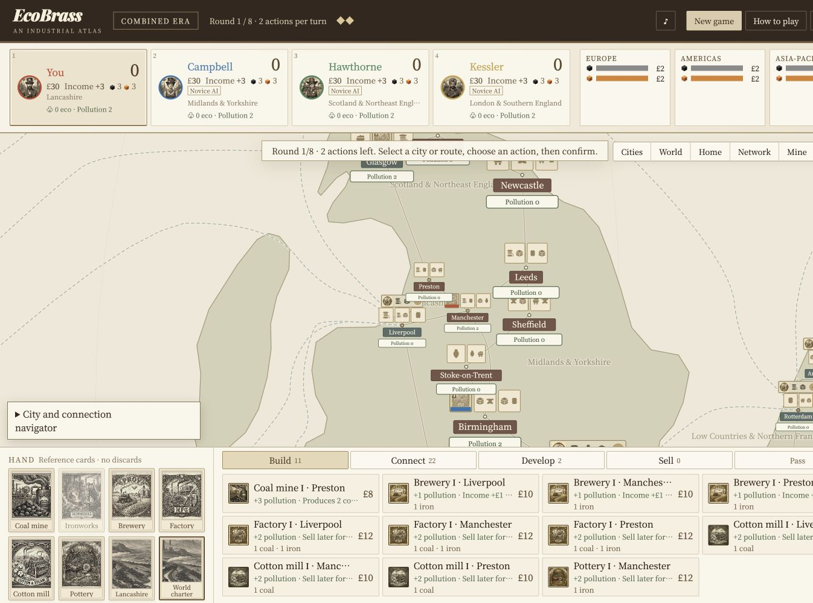
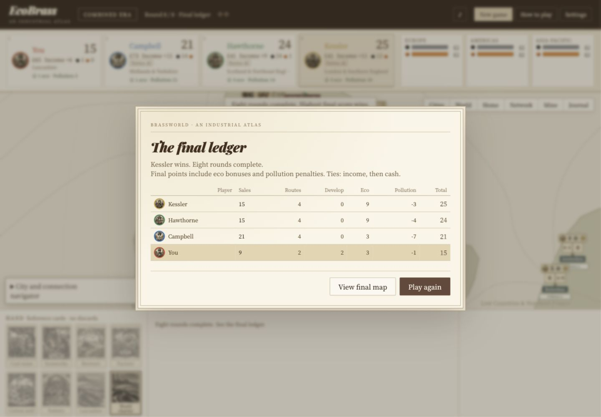

# Desktop visual verification

Captured at 1440 × 1000 using the Codex browser tools.

- `atlas-reference.png`: unchanged `dist` Atlas client, styles, artwork and renderer, given a frozen initial demo state. The fixture supplies hidden `btnMusic`, `btnMat` and `mat` hooks because those are missing in the source HTML but referenced by its JavaScript. Original gameplay is not exercised or claimed by this image.
- `ecobrass-desktop.png`: playable EcoBrass at round 1, matching home-region framing.
- `ecobrass-final-ledger.png`: a complete human browser game, after connecting, selling, building, eco-retrofitting, level-developing, selling again, and passing remaining actions through round 8. All three AI rivals take their turns.

The map/route JSON, Atlas CSS, base CSS, fonts, image files and art module are shared unchanged. EcoBrass adds resource/pollution values to player cards, corrects captions, changes rule text/actions and removes the unused dock grid track left by the original missing panel. This is not a pixel-identical comparison; environmental indicators and functional English instructions necessarily differ.

